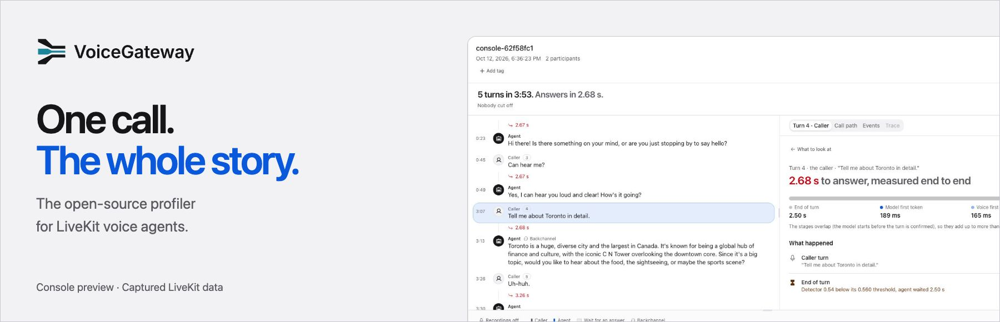
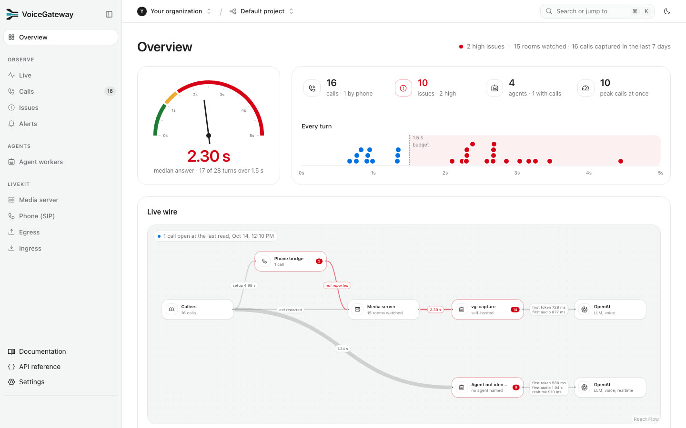
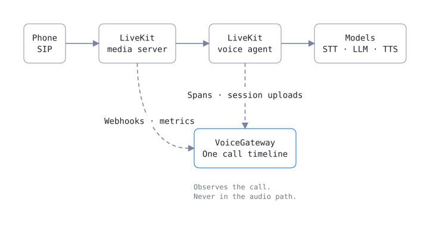
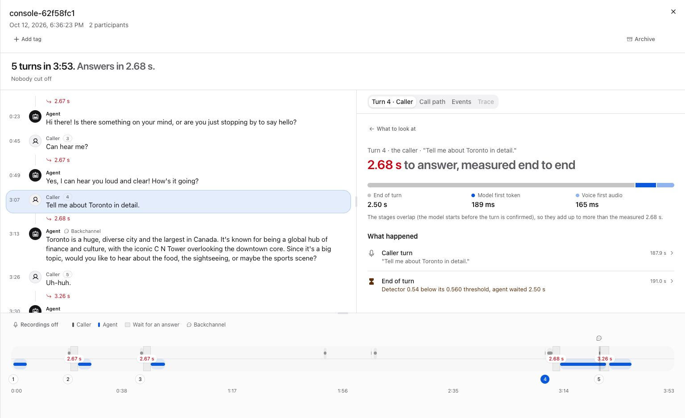

<picture>
  <source media="(prefers-color-scheme: dark)" srcset="docs/assets/readme/hero-dark.jpg" />
  
</picture>

<div align="center">
  <h3><a href="#quickstart">Try the console</a> · <a href="https://voicegateway.dev">Website</a> · <a href="docs/specs/v1-connect-plan.md">V1 roadmap</a></h3>
  <p><a href="dashboard/README.md">Console guide</a> · <a href="CONTRIBUTING.md">Contribute</a> · <a href="https://github.com/mahimailabs/voicegateway/issues/new/choose">Report a bug</a> · <a href="https://discord.gg/ysFaF4uSB">Discord</a></p>
  <p>
    <a href="docs/progress.md"></a>
    <a href="https://github.com/mahimailabs/voicegateway/actions/workflows/dashboard.yml"></a>
    <a href="LICENSE"></a>
  </p>
</div>

VoiceGateway profiles **LiveKit voice calls from the phone line to the model**. Inspect the transcript, turn timings, agent activity and infrastructure around a call to understand where it slowed down or went wrong.

> [!NOTE]
> **V1 console preview.** The console uses captured LiveKit sessions; Live replays recorded observations. The Go backend and hosted Cloud service are in development. The published Python release is the earlier product.

## Features

Available in the **captured-data console preview**:

<picture>
  <source media="(prefers-color-scheme: dark)" srcset="docs/assets/readme/overview-dark.jpg" />
  
</picture>

- **Call inspection:** transcripts, individual turns, events and agent spans when captured.
- **Latency breakdowns:** measured answer time, end-of-turn wait, model first token and voice first audio. Overlapping stages are explained rather than added together.
- **Usage visibility:** reported tokens, audio seconds and characters, without estimated model prices.
- **LiveKit infrastructure views:** rooms, participants, agent workers, SIP, egress and ingress observations around the call.
- **Issues and alert-rule previews:** grouped findings and seven supported rule previews. Notification delivery is planned for V1.
- **Live replay:** explore captured room activity over time. The real-time backend feed is planned for V1.
- **Embeddable widget previews:** answer time, calls, one call, turn anatomy and issues. Production tokens and origin enforcement are planned for V1.

Unreported measurements stay **unknown**. Traces, usage and recordings appear only when the capture provides them. See [the V1 roadmap](#the-road-to-v1) for backend and hosted capabilities still being built.

## How it fits

<picture>
  <source media="(prefers-color-scheme: dark)" srcset="docs/assets/readme/call-path-dark.svg" />
  
</picture>

**VoiceGateway stays outside the audio path.** The V1 platform joins LiveKit webhooks, server metrics, agent spans and session uploads into one call view. If the profiler is unavailable, the agent's call must carry on. See the [architecture](ARCHITECTURE.md) and [capture design](docs/decisions/0014-livekit-observability-endpoints.md).

## Quickstart

Run the captured-data console locally with **Node.js 24** and npm. No LiveKit credentials are needed for this preview.

```bash
git clone https://github.com/mahimailabs/voicegateway.git
cd voicegateway
npm --prefix dashboard ci
make dev
```

Open **[localhost:5180](http://localhost:5180)**, choose **Calls**, then open a captured session and select a caller turn.

### Inspect a real turn

<picture>
  <source media="(prefers-color-scheme: dark)" srcset="docs/assets/readme/call-dark.jpg" />
  
</picture>

In this captured session, the caller asks about Toronto. The inspector shows the turn detector below its threshold and a **2.50 s end-of-turn wait**. That makes the next investigation specific: endpointing behaviour, with the transcript and measured turn timings beside it.

[Read the console guide](dashboard/README.md) · [Watch the existing walkthrough](docs/assets/voicegateway-teaser.gif)

## The road to V1

The preview establishes the console and its captured evidence. The next work connects it to authenticated ingest, durable storage and project-scoped APIs, then adds live updates and server-backed actions.

- **Self-hosted:** the planned V1 platform runs on your infrastructure. Its install and first-call journey are still being built.
- **VoiceGateway Cloud:** the same product hosted, with self-serve signup, checkout and workspace provisioning. It is not available yet; follow [voicegateway.dev](https://voicegateway.dev) for updates.
- **Next capabilities:** notifications, opt-in recording retention, MCP access, capacity testing and authorised embeds. Existing previews do not imply an operational backend.

[Connect execution plan](docs/specs/v1-connect-plan.md) · [Current progress](docs/progress.md) · [Product scope](PRODUCT.md) · [Decisions](docs/decisions/)

## Contribute

Pick an [open issue](https://github.com/mahimailabs/voicegateway/issues), agree on scope and open a focused PR against `main`. Start with [CONTRIBUTING.md](CONTRIBUTING.md) for current V1 setup and the separate published-Python workflow.

From the repository root:

```bash
make test
make lint
```

These run the Go tests (container tests need Docker) and lint, plus the dashboard tests, lint and TypeScript checks. `make up` starts the six-service stack. The [Phase 1 spec](docs/specs/phase01-console.md) and [progress notes](docs/progress.md) identify the remaining API and UI-test work.

## Community and security

[Discord](https://discord.gg/ysFaF4uSB) · [Report a bug](https://github.com/mahimailabs/voicegateway/issues/new/choose) · [Contributor code of conduct](CODE_OF_CONDUCT.md)

Please report vulnerabilities privately using [SECURITY.md](SECURITY.md).

## License

**Free to self-host.** Code outside `ee/` uses the [MIT license](LICENSE); code inside it uses the [Enterprise license](ee/LICENSE). VoiceGateway Cloud will host the same product. [Read the boundary](docs/decisions/0017-oss-enterprise-cloud-boundary.md).

<!-- GitAds-Verify: B26PKZL6HHS6F2ZU9NAHRIA9OQHS919R -->
<details>
<summary>Sponsors</summary>

[](https://gitads.dev/v1/ad-track?source=mahimailabs/voicegateway@github)

</details>
