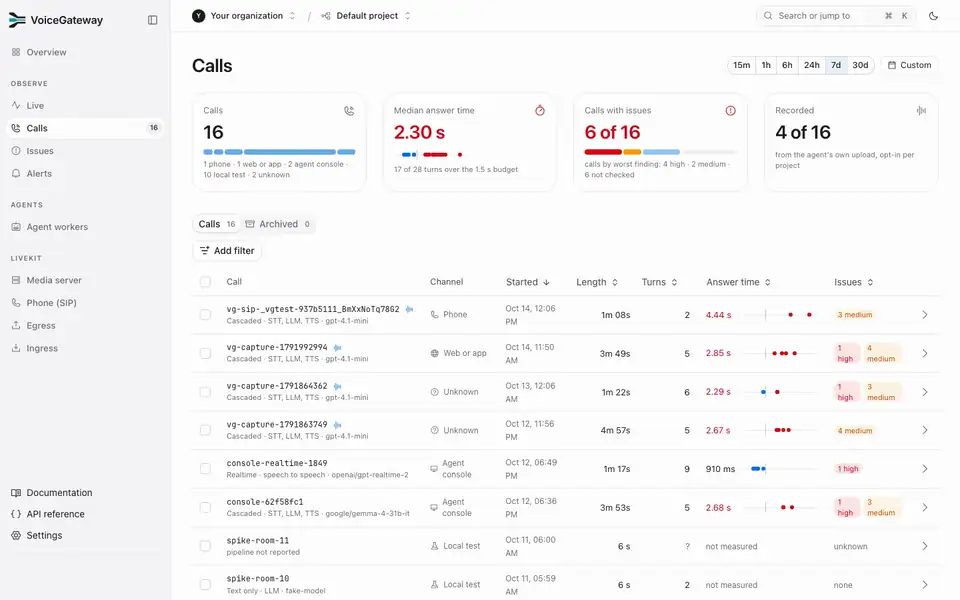
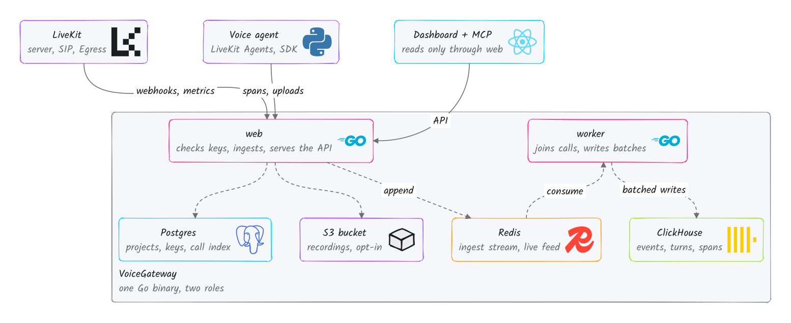

<p align="center">
  <picture>
    <source media="(prefers-color-scheme: dark)" srcset="dashboard/src/assets/brand/wordmark-dark.svg" />
    
  </picture>
</p>

<h3 align="center">One call. The whole story.</h3>
<p align="center">The open-source profiler for LiveKit voice agents, from the phone line to the model.</p>

<div align="center">
  <h3><a href="#quickstart">Self-host</a> · <a href="https://docs.voicegateway.dev">Docs</a> · <a href="https://voicegateway.dev">Website</a> · <a href="https://github.com/mahimailabs/voicegateway/issues/320">V1 roadmap</a></h3>
  <p><a href="https://docs.voicegateway.dev/get-started/python-sdk">Python SDK</a> · <a href="CONTRIBUTING.md">Contribute</a> · <a href="https://github.com/mahimailabs/voicegateway/issues/new/choose">Report a bug</a> · <a href="https://discord.gg/ysFaF4uSB">Discord</a></p>
  <p>
    <a href="docs/progress.md"></a>
    <a href="https://github.com/mahimailabs/voicegateway/actions/workflows/dashboard.yml"></a>
    <a href="https://pypi.org/project/voicegateway/"></a>
    <a href="LICENSE"></a>
  </p>
</div>

<picture>
  <source media="(prefers-color-scheme: dark)" srcset="docs/assets/readme/hero-dark.webp" />
  
</picture>

VoiceGateway profiles **LiveKit voice calls from the phone line to the model**. Every call gets one view: the transcript and recording, each turn's timings, the agent's spans, and the media server, SIP, egress and agent workers around it. You see where a call slowed down or went wrong, and which layer did it.

> [!NOTE]
> **V1 preview.** [Self-host](docs/self-hosting.md) the Go backend and console against your own LiveKit project today. Alert delivery and capacity tests are still being built ([roadmap](https://github.com/mahimailabs/voicegateway/issues/320)). VoiceGateway Cloud, the same product hosted, opens at [voicegateway.dev](https://voicegateway.dev).

## Features

<picture>
  <source media="(prefers-color-scheme: dark)" srcset="docs/assets/readme/overview-dark.jpg" />
  
</picture>

- **Call inspection:** transcript, turns, LiveKit events, the agent's spans and reported usage, in one drawer. Opt-in recordings play beside the transcript.
- **Turn diagnosis:** speech to text, turn detection, model first token, tools and voice first audio on the turn's own clock. Overlapping stages are shown as overlapping, never added up.
- **Issues:** problems found on many calls become one issue, with the calls as evidence. Resolve, ignore, tag or archive them; a resolved issue that comes back shows as regressed.
- **Every LiveKit layer:** media server rooms and participants, SIP trunks and call legs, egress and ingress jobs, and agent workers with jobs, load, CPU and memory.
- **Live:** a project-scoped feed pushed from the worker, with stale and disconnected sources marked as such.
- **For your team and tools:** organisations, roles and invites, Google, GitHub or Auth0 sign-in, project API keys, an [MCP server](https://docs.voicegateway.dev/team/mcp) for coding agents, signed [embeds](https://docs.voicegateway.dev/team/embeds) for your own pages, and a [Python SDK](sdk/python/README.md) for custom call fields.
- **Alerts:** seven rules preview on your real calls today; delivery by email and webhook is next.

Unreported measurements stay **unknown**, never zero. Traces, usage and recordings appear only when the agent sends them.

## How it fits

<picture>
  <source media="(prefers-color-scheme: dark)" srcset="docs/assets/readme/call-path-dark.svg" />
  
</picture>

**VoiceGateway stays outside the audio path.** The V1 platform joins LiveKit webhooks, server metrics, agent spans and session uploads into one call view. If the profiler is unavailable, the agent's call must carry on. See the [architecture](ARCHITECTURE.md) and [capture design](docs/decisions/0014-livekit-observability-endpoints.md).

### Components

<picture>
  <source media="(prefers-color-scheme: dark)" srcset="docs/assets/readme/components-dark.svg" />
  
</picture>

One Go binary runs as **web** (checks keys, takes data in, serves the API and dashboard) and **worker** (joins events into calls, writes to ClickHouse). A Redis stream is their only link. Postgres holds projects and keys, ClickHouse everything measured, and your own S3 bucket any recordings. `make up` starts all six. See [ARCHITECTURE.md](ARCHITECTURE.md).

## Quickstart

Self-host with Docker, git and make. The installer clones the release, starts the six services and runs the preflight checks:

```bash
curl -fsSL https://voicegateway.dev/install.sh | bash
cd voicegateway
make user-add EMAIL=you@example.com
make project-add NAME="Production"   # with LIVEKIT_URL, LIVEKIT_API_KEY and LIVEKIT_API_SECRET set
```

Sign in at [localhost:8080](http://localhost:8080). The **Connect your agent** panel gives the one variable your agent needs, `LIVEKIT_OBSERVABILITY_URL`, and the webhook URL for LiveKit. Start the agent session with `record=True` and place a call. [Read the self-hosting guide](docs/self-hosting.md) or try the [example agent](examples/livekit-agent/README.md).

### Look around without LiveKit

Run the console on captured LiveKit sessions with **Node.js 24** and npm:

```bash
git clone https://github.com/mahimailabs/voicegateway.git
cd voicegateway
npm --prefix dashboard ci
make dev
```

Open **[localhost:5180](http://localhost:5180)**, choose **Calls** and open a call.

### Inspect a real turn

<picture>
  <source media="(prefers-color-scheme: dark)" srcset="docs/assets/readme/call-dark.jpg" />
  
</picture>

In this captured call, the caller asks for the status of order 1042. Every measured answer is over the 1.5 s budget, and turn 2 is the slowest at **3.04 s**. Its breakdown shows where the time went: **1.38 s to the voice's first audio**, against 685 ms to the model's first token and a 668 ms end-of-turn delay. That makes the next step specific: the text-to-speech provider before the prompt.

[Read the console docs](https://docs.voicegateway.dev/console/calls)

### Upgrading from the API token

`VOICEGATEWAY_API_TOKEN` is gone. Create a key per project with `voicegateway key create --org <org> --project <project> --name <name>` (or in Settings, Access, API keys), send it as `Authorization: Bearer <key>`, then delete the variable.

## The road to V1

V1 is 32 of 39 tasks done; the [roadmap issue](https://github.com/mahimailabs/voicegateway/issues/320) lists each one and what is left.

- **Self-hosted:** runs on your infrastructure today as a preview. Follow [Self-hosting](docs/self-hosting.md).
- **VoiceGateway Cloud:** the same product hosted, with self-serve sign-up and checkout. Follow [voicegateway.dev](https://voicegateway.dev).
- **Next:** alert evaluation and delivery, more alert channels, the capacity test runner and a 1,000-call load test.

[Current progress](docs/progress.md) · [Product scope](PRODUCT.md) · [Decisions](docs/decisions/)

## Contribute

Pick an [open issue](https://github.com/mahimailabs/voicegateway/issues), agree on scope and open a focused PR against `main`. Start with [CONTRIBUTING.md](CONTRIBUTING.md).

From the repository root:

```bash
make test
make lint
```

These run the Go tests (container tests need Docker) and lint, plus the dashboard tests, lint and TypeScript checks. `make up` starts the six-service stack.

## Community and security

[Discord](https://discord.gg/ysFaF4uSB) · [Report a bug](https://github.com/mahimailabs/voicegateway/issues/new/choose) · [Contributor code of conduct](CODE_OF_CONDUCT.md)

Please report vulnerabilities privately using [SECURITY.md](SECURITY.md).

## License

**Free to self-host.** Code outside `ee/` uses the [MIT license](LICENSE); code inside it uses the [Enterprise license](ee/LICENSE). VoiceGateway Cloud hosts the same product. [Read the boundary](docs/decisions/0017-oss-enterprise-cloud-boundary.md).

<!-- GitAds-Verify: B26PKZL6HHS6F2ZU9NAHRIA9OQHS919R -->
<details>
<summary>Sponsors</summary>

[](https://gitads.dev/v1/ad-track?source=mahimailabs/voicegateway@github)

</details>
