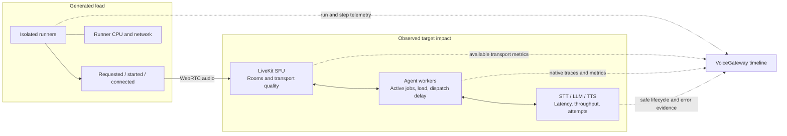

# Capacity telemetry audit and proposed implementation

2026-10-19. Audit only. No backend implementation or measured capacity result.

## Evidence and version scope

Upstream Python Agents source inspected at commit `453718aa0550e57bd3ee57a57aa145ea984be145` using LiveKit Docs MCP. This is not a blanket guarantee for installed plugin versions. Existing repository evidence includes Agents 1.8.7 captures in `internal/turn/testdata/agents-1.8.7-call.spans.jsonl`, with `llm_request`, `llm_request_run`, `tts_request`, `tts_request_run` and `event_loop_blocked` spans. Compatibility fixtures must gate each supported SDK/plugin combination.

Source root: https://github.com/livekit/agents/tree/453718aa0550e57bd3ee57a57aa145ea984be145/livekit-agents/livekit/agents

| Source | Finding | Consequence |
| --- | --- | --- |
| llm/llm.py | Parent request spans and child attempt spans; retry count and provider request IDs; errors emitted on recoverable and terminal failures | Reuse attempt intervals; distinguish operation latency including retry backoff from active attempts |
| tts/tts.py | Request/attempt spans, segment metrics, retry logic; failed metrics may be suppressed | Metrics alone cannot supply failure denominators; do not count wrapper and child streams twice |
| stt/stt.py | Streaming usage events and error events; streaming metric duration is zero; base stream path lacks the equivalent attempt span wrapper | Add lifecycle coverage only where native evidence is absent; open connections differ from processing activity |
| voice/agent_activity.py | Forwards model errors through session error events before session shutdown handling | Subscribe once, not at both session and component levels |
| voice/events.py, _exceptions.py | Error object excludes raw exception during serialization; APIStatusError carries status_code and request_id in memory | Extract allowlisted status/type/recoverable fields in process; never serialize response bodies or arbitrary exception text |
| telemetry/otel_metrics.py | Native latency histograms, usage counters, connection acquisition and event-loop blockage; turn metrics flushed at session end | Reuse native instruments for final evidence; do not promise live turn updates from session-end histograms |
| telemetry/metrics.py | Worker load, active jobs, child-process count, process initialization histogram | Reuse native Prometheus instruments; worker load is configurable and not necessarily CPU utilization |
| internal/join/spans.go:decode | Normalized spans retain timing, attributes and status code but omit span events | Preserve safe structured error evidence, not raw exception message/stack/body |
| internal/join/metrics.go | Usage-sum ingestion | Extend typed ingestion for required histograms rather than create duplicate metrics |
| internal/scrape/workers.go; internal/api/workers.go | Worker load and jobs sampled every 15 s | Already useful, but not exact live component concurrency |
| internal/api/mediaserver.go | Room/participant/dispatch API reads | Not an SFU performance scraper |

## Implementation sequence

1. **Evidence contract and ingestion.** Identify run, step, room, job, worker, component, provider, model, logical operation and attempt. Preserve OTel trace/span IDs, source clock and coverage. Add safe error fields and histogram ingestion. Keep SDK version provenance. Never infer physical provider region from latency.
2. **Small agent-side adapter.** Reuse native LLM/TTS spans via OTel hooks. Capture structured error status before serialization using the public error event. Test correlation under concurrent requests: an event may have no request ID or current attempt span. Leave unmatched evidence unmatched. Add version-tested STT/Realtime lifecycle hooks only where missing; do not monkey-patch private retry loops or reimplement provider clients. Provider-internal retries remain unknown unless exposed.
3. **Live state and final reconciliation.** Completed spans support retrospective overlap. Live UI needs start/end signals or in-process gauges plus heartbeats. Use a bounded nonblocking export queue, report dropped data, and expire stale worker state as unknown. Deduplicate attempts and reconcile final results. Cross-worker overlap needs clock alignment; do not add worker peak values. Never claim exact maxima from sampled gauges or sampled traces.
4. **Infrastructure telemetry.** Keep runner telemetry independent of target telemetry. Reuse worker Prometheus. Add opt-in SFU Prometheus collection for self-hosted deployments and client-side WebRTC stats for transport evidence where supported. Host CPU/memory needs a host/container source. LiveKit Cloud exposes only allowed APIs/telemetry, not presumed SFU host access. Node metrics are shared infrastructure evidence, not automatically attributable to one call.
5. **Aggregation and UI.** Group by test run and step. Compute latency distributions with sample counts, throughput per wall-clock window, attempt-level 429/error rates and operation success separately. Count cancellations separately. Do not average percentiles or tokens/sec values. Show source, freshness and coverage. Find the highest tested step meeting configured thresholds; runner saturation makes target capacity inconclusive.

Acceptance scenarios: retry then success; terminal 429; cancellation; overlapping requests on a shared model; fallback to another provider; STT reconnect; missing IDs; duplicate exports; delayed events; worker crash; telemetry loss; no metrics endpoint; runner saturation. Keep content capture off for capacity telemetry.

## Proposed visual redesign

Replace repeated session circles with a left-to-right load-versus-impact layout:

Top: requested sessions, actually started, connected, completed. Left: a growing traffic stream and runner health. Right: SFU transport lane, worker lanes and provider metrics with synchronized time cursors. Show dispatch pending beside workers, but not-generated sessions beside the runner. A runner failure must never appear as an agent queue. Mark observed degradation and missing data rather than assert root cause from correlation. Details reveal individual sessions; the default view shows counts and trends. Keep media flow separate from dashed telemetry flow. Unknown regions collapse into details.

The current frontend curves remain fictional. They do not establish thresholds or evidence for any named provider.
